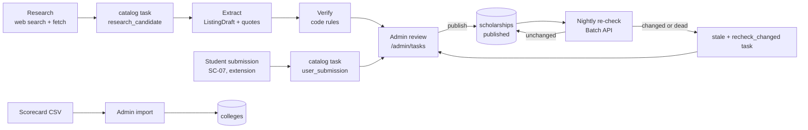

# Catalog

The catalog is the shared, non-personal reference data every student sees: scholarship listings, colleges, and aid rules and deadlines. Its rule is product rule 3: no fact without a source. Every listing carries a source URL and a verified date, or it's labeled unconfirmed. `@scholarcrew/catalog` (plan 11) finds and checks listings but never publishes them. Admins publish through `@scholarcrew/core/admin` (plan 08).

## Pipeline

## Sources

| Source | How it enters | Result |
|---|---|---|
| Research | An admin requests a state or county (`POST /api/v1/admin/research`), which enqueues `catalog.research`. The researcher runs a model loop with the `web_search` and `web_fetch` server tools and a strict `submit_candidates` tool (up to 25 pages). | One `research_candidate` task per new URL, then a `catalog.extract` job for each. |
| Student submissions | A student submits a URL and notes (`POST /api/v1/scholarships/local`) or saves a page from the extension (`POST /api/v1/extension/save-page`). | A `draft` listing with `visibility = submitter_only` (provider "Unknown", amounts 0, no deadline, the student's local area) plus a `user_submission` task. Only that student sees it, labeled unverified. |
| Reports | Anyone signed in can report a listing (wrong deadline, dead link, scam, wrong amount, other). | A `catalogReports` row and a `report` task. |
| College Scorecard CSV | An admin uploads an extract (`POST /api/v1/admin/colleges/import`, `text/csv`). | `parseScorecardCsvWithErrors` maps rows; `admin.importColleges` inserts new colleges and refreshes Scorecard fields on existing ones. |

### Research details

- The system prompt asks for pages from local foundations, civic clubs, credit unions, employers, school districts, and local chapters, and tells the model to skip sweepstakes, contact-collecting drawings, paid matching services, and aggregators.
- `CATALOG_ALLOWED_DOMAINS` (comma list, may be empty) becomes `allowed_domains` on web search and a verification rule.
- Each server tool may be used up to 8 times per request; the loop runs at most 6 turns, handles `pause_turn` by calling again, and returns no candidates on a refusal or if nothing valid is submitted. Calls use server-side fallbacks and effort `medium`.
- Dedupe: URLs are normalized (http(s) only, lowercase host, no hash or trailing slash). A URL is skipped if any listing already uses it (as `url` or `sourceUrl`) or a task for it is `open`, `in_review`, or `rejected`, so a page an admin turned down doesn't come back.

The overview §14 shows `max_uses: 5` for the server tools; plan 11 uses 8. One of them should change.

### Scorecard import

Required columns are `UNITID`, `INSTNM`, `STABBR`, and `CONTROL`. `CITY`, `ADM_RATE`, `COSTT4_A`, and the net-price columns (`NPT4` and `NPT41` to `NPT45`, `_PUB` or `_PRIV` by control) are optional. Empty, `NULL`, and `PrivacySuppressed` count as missing; negative net prices become $0. Bad rows are skipped and reported by line number. `parseScorecardCsvWithErrors` also returns `lines`, the CSV line of each kept row, so the import route reports `importColleges` errors on the same line numbers as parse errors. Re-importing refreshes only the Scorecard fields, so curated fields (merit tiers, deadlines, requirements, test and outside-scholarship policies) are kept.

Open: no drafted plan provides an editor for those curated college fields. For `aidRules` and `aidDeadlines`, dev uses sample rows from the seed; admins maintain real values at /admin/aid.

## Extraction

`extractForTask(deps, taskId)` (the `catalog.extract` handler) works only on an open `research_candidate` task:

1. Fetch the page with `createFetchPage`: public http(s) hosts only (loopback, private ranges, link-local, `.local`, `.internal`, and IPv6 literals are refused), 10-second timeout, 2 MB cap, `text/html` or `text/plain` only. HTML becomes text with a small in-repo `htmlToText`.
2. If the page can't be read, store a failed report explaining why (network error, HTTP status, wrong content type, empty page).
3. Otherwise call `extractListing`: one `model.extract` call at effort `low` with `ListingDraft` as the JSON schema. The page text (first 50,000 characters) is wrapped as untrusted data; the source URL follows as plain text.
4. The prompt requires values the page states (null otherwise), whole-dollar amounts, a deadline only when a specific date and year are given, any application fee exactly as stated, and essay prompts copied word for word. **Every filled field needs a `fieldQuotes` entry with the exact sentence that supports it.**
5. Run `verifyDraft` and store the draft and its report on the task. The task stays open for an admin either way.

Open: `extractForTask` skips `user_submission` tasks, and no drafted plan enqueues extraction for them. Student submissions reach admins as a URL and notes with no draft or report.

## Verification rules

`verifyDraft(draft, pageText, now, opts?)` is pure code (CA-03). `ok` means no issues at all.

| Code | Fires when |
|---|---|
| `missing_field` | No name, no provider, no maximum amount, or the URL isn't a valid web address. |
| `deadline_past` | The deadline is before today (UTC date). |
| `amount_invalid` | Minimum above maximum, maximum of $0, or maximum above $100,000. |
| `quote_not_found` | A field quote isn't on the page after normalizing quotes, dashes, spaces, and case. |
| `scam_signal` | `detectScamSignals` finds an application fee, a guaranteed award, a bank or card request, or sweepstakes patterns. A stated fee counts. "No application fee" doesn't. |
| `domain_not_allowed` | `CATALOG_ALLOWED_DOMAINS` is set and the listing's host isn't one of them or a subdomain. |

The report also lists the scam flags found. The admin decides whether to carry them onto the listing's `scamFlags`.

## Human review and publishing

- `/admin/tasks` lists tasks by status and kind: research candidates, user submissions, reports, and re-check changes. The admin compares each field with its quote.
- `admin.upsertScholarship` creates or edits a listing (every field, including eligibility rules and scam flags). `admin.resolveCatalogTask` resolves or rejects a task with a note; resolving can publish a listing in the same transaction.
- **Only an admin publishes (CA-04).** Publishing sets `status = published`, `visibility = public`, `verifiedAt = now`, and `verifiedById`. `setScholarshipStatus` can also retire or flag a listing.
- Resolving a report closes its task. Every admin write is audited.

## Nightly re-check

`catalog.recheck` runs `startRecheck` daily at 08:00 UTC:

1. Select up to 200 `published` listings that were verified more than 30 days ago, never verified, or are due within 45 days, skipping any fetched in the last 7 days. Oldest verification first.
2. Fetch each listing's `sourceUrl` (or `url`).
   - Fetch throws (DNS, timeout): skip it this run. Nothing changes.
   - Dead or unreadable (HTTP error, wrong type, empty): mark it `stale` and create a `recheck_changed` task with the reason.
   - Same SHA-256 hash as the last fetch: record the fetch in `scholarshipSources` and refresh `verifiedAt`.
   - Different hash: queue it for re-extraction.
3. Send every changed page to one Message Batches request (`EXTRACT_SYSTEM`, effort `low`, the `ListingDraft` schema as JSON output, no fallbacks because the Batch API rejects them). Record the batch in `recheckBatches` and the new fetches in `scholarshipSources` (hash plus a 500-character excerpt).

`catalog.recheck.collect` runs `collectRecheck` every 30 minutes:

1. Skip batches that haven't ended.
2. For each result, compare the new draft with the current listing field by field (name, provider, url, amounts, renewable, deadline, application fee, essays).
   - Same: refresh `verifiedAt`.
   - Different (a newly stated fee counts): mark the listing `stale` and create a `recheck_changed` task with `before`, `after`, and a verification report. Quote checks are off here because only the excerpt is stored.
   - Unparseable or missing result: count it as failed and create a review task without changing status.
3. Mark the batch `collected`.

A stale listing stays stale until an admin reviews it; stale listings aren't re-checked again.

## What students see

| Situation | Shown as |
|---|---|
| Published and verified in the last 30 days | Normal listing with the source link and "verified <date>". |
| Verified more than 30 days ago, or status `stale` | Still visible to signed-in students, marked stale (`isStale`). The public directory shows only listings with status `published`, so a `stale` listing drops out of it until reviewed. |
| Never verified, or the student's own submission | An `unverified` badge. Submissions are visible only to the student who sent them. |
| Scam-flagged | Kept in search with the reason shown; left out of matches, weekly plans, and the public state directory. |
| `flagged` or `retired` | Never shown. |
| In a crew reply | Receipt items for catalog entries carry the exact `sourceUrl` and `verifiedAt`; the source guard rejects any that don't match. Specialists are told to call anything without `verifiedAt`, or stale, unconfirmed. |

Any signed-in user can report a listing they can see, and the report becomes an admin task. Helper-link viewers (counselors, recommenders) have no account, so they can't report today, although the system sketch says counselors can.
