# Data model

All state lives in one Postgres 16 database. Plan 03 implements the schema in `packages/db/src/schema/*.ts` with Drizzle, exactly as listed in `plans/00-overview.md` §8. That section is the contract for every column, default, and index; this page explains how the pieces fit. pg-boss keeps its own tables in the `pgboss` schema, outside Drizzle.

## Table groups

| Group | Schema file | Purpose | Tables |
|---|---|---|---|
| Identity and access | `identity.ts` | Accounts, sessions, sign-in links, API tokens, rate-limit counters, the audit log, the dev email outbox. | 7 |
| Profile and memory | `memory.ts` | The profile, memory facts and candidates, encrypted sensitive facts, decisions, the Story Bank. | 5 (plus `storyUses`, see below) |
| Family and helpers | `family.ts` | Families and members, invites, per-category share settings, budgets, family tasks, helper links. | 7 |
| Catalog | `catalog.ts` | Shared, non-personal reference data: scholarships and their fetched sources, colleges, aid rules and deadlines, the admin review queue, reports, batch re-check bookkeeping. | 8 |
| Pipeline | `pipeline.ts` | Each student's working records: college list and application items, recommenders, scholarship applications, essays with versions and comments, story uses, scores, activities, service hours, cost estimates, documents and blobs, award letters, aid checklists, sweep runs, plan items. | 20 |
| Crew | `crew.ts` | Conversations, messages, crew jobs, per-call model usage, action-card receipts. | 5 |
| Ops | `ops.ts` | Notifications and preferences, subscriptions, Stripe event receipts, usage counters, sponsor codes, exports. | 8 |

That's 60 tables. §8 lists `storyUses` under memory; plan 03 declares it in `pipeline.ts` next to `essays` to avoid an import cycle. The table is the same.

## Main relationships

```mermaid
erDiagram
    users ||--o| profiles : "has"
    users ||--o{ familyMembers : "joins"
    families ||--o{ familyMembers : "has"
    users ||--o{ shareSettings : "student sets"
    families ||--o{ shareSettings : "scoped to"
    users ||--o{ scholarshipApplications : "owns"
    scholarships ||--o{ scholarshipApplications : "applied to"
    users ||--o{ collegeList : "owns"
    colleges ||--o{ collegeList : "listed"
    collegeList ||--o{ applicationItems : "requires"
    users ||--o{ essays : "owns"
    essays ||--o{ essayVersions : "saved as"
    essays ||--o{ essayComments : "reviewed in"
    users ||--o{ stories : "owns"
    stories ||--o{ storyUses : "used in"
    essays ||--o{ storyUses : "uses"
    users ||--o{ offers : "owns"
    colleges ||--o{ offers : "from"
    offers ||--o{ offerLines : "lists"
    users ||--o{ conversations : "owns"
    families |o--o{ conversations : "family room"
    conversations ||--o{ messages : "contains"
    users ||--o{ crewJobs : "owns"
    conversations |o..o{ crewJobs : "conversationId (no FK)"

    users {
        uuid id PK
        text email UK
        role role
        user_status status
        text timeZone
    }
    profiles {
        uuid userId PK
        int gpaUnweightedX100
        text state
    }
    shareSettings {
        uuid studentId PK
        uuid familyId PK
        share_category category PK
        bool enabled
    }
    scholarships {
        uuid id PK
        text slug UK
        int amountMaxUsd
        date deadline
        catalog_status status
        timestamptz verifiedAt
    }
    colleges {
        text id PK "IPEDS unit id"
        int admitRateX1000
        int costOfAttendanceUsd
    }
    scholarshipApplications {
        uuid id PK
        uuid ownerId FK
        uuid scholarshipId FK
        app_stage stage
    }
    collegeList {
        uuid id PK
        uuid ownerId FK
        text collegeId FK
        text season
    }
    essayVersions {
        uuid id PK
        uuid essayId FK
        int version
        uuid authorId FK
    }
    offerLines {
        uuid id PK
        uuid offerId FK
        int amountUsd
        offer_line_category category
        text citedText
    }
    messages {
        uuid id PK
        uuid conversationId FK
        message_author authorKind
        jsonb reply "CrewReply"
    }
    crewJobs {
        uuid id PK
        job_kind kind
        job_status status
        jsonb progress
        int costMicros
    }
```

Unique keys that enforce product rules: `scholarshipApplications (ownerId, scholarshipId)`, `collegeList (ownerId, collegeId, season)`, `essayVersions (essayId, version)`, `storyUses (storyId, essayId)`, `actionReceipts (messageId, cardId)` (a card applies once), `notifications.dedupeKey` (a reminder fires once), `aidChecklistItems (ownerId, awardYear, program, key, collegeId)` with `NULLS NOT DISTINCT`.

Several reference columns are plain values with no foreign key, so a row can point at something that's gone: `crewJobs.conversationId`, `requestMessageId`, `resultMessageId`; `applicationItems.essayId`; `essays.targetCollegeId` and `targetScholarshipId`; `storyUses.collegeId` and `scholarshipId`; `recRequests.collegeListId`; `auditEvents.actorId`. Code that reads them handles a missing target.

## Conventions

| Topic | Rule |
|---|---|
| IDs | UUID strings, default `gen_random_uuid()`. College ids are the IPEDS unit id as text. |
| Names | TypeScript property names in camelCase; Drizzle maps them to snake_case columns. Enums are `pgEnum` named `<name>_enum`. The `exports` table's TypeScript name is `exportsTable`. |
| Money | Integer whole US dollars, field names ending in `Usd`. Yearly unless the name says otherwise (`fourYearUsd`). Model cost is integer micro-dollars (`costMicros`). |
| Scaled numbers | GPA as `gpaX100` (3.72 is 372), admit rate as `admitRateX1000` (45.2% is 452). Domain objects expose plain numbers. |
| Calendar dates | `date` columns in string mode (`YYYY-MM-DD`): deadlines, `dueOn`, `servedOn`, `weekStart`. No time zone. |
| Instants | `timestamptz`, mapped to `Date` inside `db` and `core` and to ISO strings in domain objects and the API. `createdAt`/`updatedAt` default to `now()`, but services set them from `deps.clock.now()`. |
| Weeks and seasons | A week starts Monday in the student's `timeZone` (default `America/Chicago`). Seasons roll over Aug 1 (`2026-27`); award years roll over Oct 1 (`2027-28`). |
| JSON | `jsonb` typed with the domain type (`eligibility: EligibilityRule[]`, `reply: CrewReply`, `progress: ProgressEvent[]`). |
| Encrypted data | `bytea` triples (`ciphertext`, `iv`, `tag`) for sensitive facts, blobs, and the SMS phone number. |
| Cascades | Every foreign key to `users` cascades on delete, so purging a user removes their rows. Three are `set null` instead: `families.createdById`, `scholarships.submittedById`, `catalogReports.reporterId`. Child rows cascade from their parent (versions from essays, lines from offers, messages from conversations, items from college-list entries). `offers.documentId`, `agentRuns.jobId`, and `catalogTasks.scholarshipId` are `set null`. `auditEvents` has no foreign keys, so audit history outlives the user. |

## Full table list

See `plans/00-overview.md` §8 for columns, defaults, and indexes.

| Table | Group | Purpose |
|---|---|---|
| `users` | identity | One row per person: email, role, birth year, time zone, status (`active`, `blocked_underage`, `deleted`). |
| `sessions` | identity | 30-day sessions, stored as a token hash. |
| `magicLinks` | identity | One-time sign-in links (hash, 15-minute expiry, `usedAt`). |
| `apiTokens` | identity | Extension bearer tokens with scopes. |
| `rateLimits` | identity | Fixed-window counters keyed by string (`ml:ip:<ip>`). |
| `auditEvents` | identity | Who did what to which entity. |
| `devOutbox` | identity | Captured email when `RESEND_API_KEY` is empty. |
| `profiles` | memory | Profile basics per user. |
| `memoryFacts` | memory | Facts and candidates with source, visibility, status, supersede chain. |
| `sensitiveFacts` | memory | Encrypted opt-in matching facts, one row per kind. |
| `decisions` | memory | The decisions log. |
| `stories` | memory | Story Bank entries. |
| `families` | family | A family group. |
| `familyMembers` | family | Membership with role. |
| `familyInvites` | family | Email invites (hash, 7-day expiry). |
| `shareSettings` | family | Per-student, per-family, per-category sharing switches. |
| `familyBudgets` | family | A parent-shared yearly budget. |
| `familyTasks` | family | FAFSA, CSS, budget, and review tasks assigned to a person. |
| `helperLinks` | family | Read-only scoped links for recommenders, counselors, mentors. |
| `scholarships` | catalog | Listings with eligibility, requirements, status, visibility, scam flags, verified date. |
| `scholarshipSources` | catalog | Each fetch of a listing's page: URL, content hash, 500-character excerpt. |
| `colleges` | catalog | College records from the Scorecard import plus curated policies. |
| `aidRules` | catalog | Award-year rules (for example federal loan rates). |
| `aidDeadlines` | catalog | Federal and state aid deadlines. |
| `catalogTasks` | catalog | The admin review queue. |
| `catalogReports` | catalog | User reports on listings. |
| `recheckBatches` | catalog | Anthropic batch ids for nightly re-checks. |
| `collegeList` | pipeline | A student's colleges per season with fit, plan, status. |
| `applicationItems` | pipeline | Checklist items per listed college. |
| `recommenders` | pipeline | People the student asks for recommendations. |
| `recRequests` | pipeline | Recommendation requests and status. |
| `scholarshipApplications` | pipeline | Board cards: stage, match reasons, fit, outcome. |
| `essays` | pipeline | Essay metadata, target, limits, current version. |
| `essayVersions` | pipeline | Every saved draft with author and word count. |
| `essayComments` | pipeline | Quill, helper, and user comments anchored by quote. |
| `storyUses` | pipeline | Which story went into which essay (and school or scholarship). |
| `testScores` | pipeline | ACT, SAT, PSAT scores with sections. |
| `activities` | pipeline | Up to 10 ordered activities. |
| `serviceLogs` | pipeline | Service hours and supervisor verification. |
| `costEstimates` | pipeline | Year-1 cost per college by source (Scorecard, calculator, offer). |
| `blobs` | pipeline | Encrypted file bytes for documents and exports. |
| `documents` | pipeline | Upload metadata pointing at a blob. |
| `offers` | pipeline | Award letters per college and award year. |
| `offerLines` | pipeline | Each letter line with category, amount, page, cited text. |
| `aidChecklistItems` | pipeline | FAFSA and CSS steps. |
| `sweepRuns` | pipeline | Results of each weekly sweep. |
| `planItems` | pipeline | Weekly plan items. |
| `conversations` | crew | Rooms: my crew, family, temporary, and context rooms. |
| `messages` | crew | User and crew messages; crew messages carry the `CrewReply`. |
| `crewJobs` | crew | Status, progress, safety flag, and cost per job. |
| `agentRuns` | crew | One row per model call: role, tokens, cache use, stop reason, cost. |
| `actionReceipts` | crew | One row per applied action card. |
| `notifications` | ops | In-app notifications with a unique dedupe key. |
| `notificationPrefs` | ops | Digest day and hour, email and SMS switches, quiet hours, encrypted phone. |
| `stripeEvents` | ops | Deduplicated Stripe webhook event ids. |
| `subscriptions` | ops | Plan and Stripe ids per user. |
| `usageCounters` | ops | Crew requests and cost per user per month. |
| `sponsorCodes` | ops | Codes that grant a plan. |
| `sponsorRedemptions` | ops | Who redeemed which code. |
| `exports` (`exportsTable`) | ops | Export jobs and their blob. |

## Round 4 schema contracts

The authoritative column and index list is plans/00-overview.md §8. Offers include archivedAt; the exports binding is exportsTable. Round 4 adds stripeEvents, subscription event timestamps, job attempt/lease/creation-month fields, message share categories, token expiry, encryption key ids, unique current facts and family membership, unique active college entries and open recheck tasks, and nullable recommender-target foreign keys. Plan 03 owns the migrations and schema assertions for these contracts.
