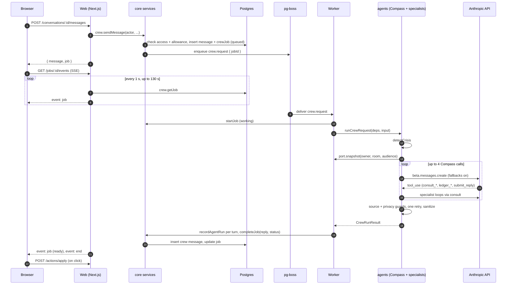

# Architecture overview

ScholarCrew is a Next.js website backed by one Postgres database and one long-running worker process. The web app serves pages and the JSON API and enqueues work. The worker runs every background job, including the AI crew, and is the only process that calls the Anthropic API for crew work. `plans/00-overview.md` is the source of truth for every name on this page; when they disagree, the overview wins.

## System diagram

The concept sketch is at [`design/ScholarCrew_System_Diagram.png`](../../design/ScholarCrew_System_Diagram.png), drawn from [`design/mockups/source/system.html`](../../design/mockups/source/system.html). It shows the browser, the Next.js server as "the only door to the data", the agent worker with its four kinds of agents, Postgres, the catalog pipeline, and outside services.

The sketch predates the plans. Where they differ, follow the plans:

| Sketch says | Plans say |
|---|---|
| "Postgres + file storage" | Files are encrypted `blobs` rows in Postgres. There's no separate file store. |
| "API & server actions" | Mutations go through `/api/v1/*` route handlers. No server actions are specified. |
| "Weekly digest by email or SMS" | The digest is email only. SMS (R3) is for 1-day reminders only (NO-05). |
| "Common Data Sets" as a source | Not used. Colleges come from a College Scorecard CSV import (AD-03). |
| "Claude API · swappable provider" | Only Anthropic is wired, and only two directories import its SDK. |

## Components

| Component | What it is | Talks to |
|---|---|---|
| Browser | React 19 pages for students, parents, helper links (`/h/[token]`), public pages, and the admin console. | Web app over HTTPS: server-rendered pages, `/api/v1/*` JSON, one SSE stream per crew job. |
| Web app (`apps/web`) | Next.js 15 app router. Pages, route handlers, edge middleware, the Stripe webhook. Sends jobs; never runs cron or queue maintenance. | Postgres (through `@scholarcrew/core`), pg-boss as a sender, Resend for magic-link email, Stripe for checkout and portal sessions. |
| Worker (`apps/worker`) | Node process that creates queues, registers cron schedules, and runs every job handler. Plan 12. | Postgres, pg-boss as a worker, Anthropic, Resend, Twilio (R3). |
| Postgres 16 | All state: users, memory, records, the shared catalog, encrypted blobs, and the pg-boss queue (schema `pgboss`). | Both processes, through one `DATABASE_URL`. |
| Anthropic API | `claude-opus-5-5` with server-side fallbacks for crew work, document reading, and catalog extraction; the Message Batches API for nightly re-checks; web search and fetch server tools for catalog research. | Worker only. |
| Stripe | Checkout, customer portal, subscription webhooks. | Web app (`/api/v1/billing/*`). |
| Resend | Transactional email over its REST API with `fetch`. With no `RESEND_API_KEY`, mail goes to the `dev_outbox` table. | Web app (magic links) and worker (`notify.email`). |

## Packages and what each owns

| Package | Owns | Imports | Plan |
|---|---|---|---|
| `@scholarcrew/domain` | Zod schemas and inferred types for every domain object, job payloads, error codes, crew contracts (`CrewReply`, `SpecialistResult`, `ContextSnapshot`). | `zod` only | 02 |
| `@scholarcrew/db` | Drizzle schema for all 59 tables, migrations, the DB client, test helpers and factories, the dev seed. | domain | 03 |
| `@scholarcrew/engines` | Pure synchronous calculators: Ledger money math, eligibility matcher, scam rules, deadlines and weeks, word and character limits, merit tiers, superscores, plan ranking. | domain | 04 |
| `@scholarcrew/jobs` | Job names, payload validation, the pg-boss client wrapper, the in-memory test client, cron schedules. | domain, pg-boss | 05 |
| `@scholarcrew/core` | Business services. Every function is `(deps, actor, ...args)` and checks access first. Identity, memory, family, billing, documents, account (06); scholarships, colleges, essays, prep, impact, helper view (07); money, aid, plan, crew, admin (08). | domain, db, engines, jobs, stripe | 06, 07, 08 |
| `@scholarcrew/agents` | The model client, the agent loop, guards, calculator tools, Compass (09), and the seven specialists (10). Reads data only through the `CrewDataPort` interface it defines. | domain, engines, Anthropic SDK | 09, 10 |
| `@scholarcrew/catalog` | Research, extraction, verification rules, batch re-checks, page fetching, Scorecard CSV parsing. | domain, db, agents | 11 |
| `@scholarcrew/ui` | Design tokens and React components ported from the mockups, styled with CSS Modules. | domain | 15 |
| `apps/web` | Pages, `/api/v1/*` routes, middleware, server helpers (`route`, `getDeps`, `requirePageActor`). | domain, db, core, engines, jobs, ui; catalog's CSV parser for the admin import (see the note below) | 13, 14, 16, 17, 18 |
| `apps/worker` | pg-boss consumers, cron registration, the `CrewDataPort` adapter over core services. | everything | 12 |
| `apps/extension` | Chrome MV3 extension (R3): autofill and "save to Scout". | web API with bearer tokens | 20 |

Boundaries that keep this layering honest:

- `agents` never imports `core` or `db`. The worker implements `CrewDataPort` over core services with a system actor and injects it, so the agents package compiles and tests with no database.
- Only `packages/agents/src/model/**` and `packages/catalog/src/anthropic.ts` import `@anthropic-ai/sdk`.
- Only `apps/web/src/server/deps.ts`, `apps/worker/src/deps.ts`, and test setup read `process.env`.
- Plan 09 never imports the specialists. Compass reaches them through the injected `consult` function, which plan 10's `makeConsult` provides and the worker wires.
- Open item: `POST /api/v1/admin/colleges/import` calls `parseScorecardCsvWithErrors` from `@scholarcrew/catalog`, but the `transpilePackages` list in the overview §14 doesn't include `@scholarcrew/catalog`. Plan 13 or 14 needs to add it (or move the parser).

## Request paths

### A page

1. The browser requests `/week`.
2. `src/middleware.ts` runs on the edge. It only checks that the `sc_session` cookie exists and redirects to `/sign-in` if not. It can't reach the database.
3. The page (a server component) calls `requirePageActor()`, which reads the cookie with `next/headers` and calls `auth.getSessionUser`. That hashes the token, looks up `sessions`, and returns a `UserActor` or redirects.
4. The page calls a core service such as `plan.getThisWeek(deps, actor, studentId)`. The service runs its access check (owner, or a parent with the right share category) and throws `not_found` for anything the actor can't see.
5. The service returns domain objects with ISO date strings, and the page renders them with `@scholarcrew/ui` components.

Client components fetch through `apps/web/src/lib/api.ts` (`api<T>(path, init)`), which calls the same `/api/v1` routes. How each screen splits server and client rendering belongs to plans 16 to 18.

### An API mutation

Example: `PATCH /api/v1/plan-items/:id` to check off an item.

1. The route file wraps its handler in `route({ auth: "user" }, handler)`.
2. For a non-GET request with cookie auth, `route` rejects any `Origin` that isn't `APP_URL` with 403 (ID-06). Bearer-token routes skip this check.
3. If the route declares a rate limit, `consumeRateLimit` counts it in `rateLimits` and throws `rate_limited` (429) past the limit.
4. The session cookie becomes an `Actor`. `body(req, PlanItemPatch)` validates the JSON with Zod and throws `invalid_input` (400) on failure.
5. `plan.updatePlanItem(deps, actor, id, patch)` checks ownership (`not_found` if it isn't yours), writes inside a transaction, and may record an audit event or enqueue a job.
6. `route` returns the result as JSON, or 204 for `undefined`. Errors become `{ "error": { "code", "message", "details"? } }` with the status from the code table in the overview §3.

### A crew request

1. The student sends a message: `POST /api/v1/conversations/:id/messages` (rate limit 30 per 10 minutes).
2. `crew.sendMessage` checks the actor can use the conversation, then `billing.assertCrewAllowance` on the room owner (402 `limit_reached` when the month's allowance is spent). In one transaction it inserts the user's `messages` row and a `crewJobs` row with status `queued`, then enqueues `crew.request` with `{ jobId }`.
3. The API returns `{ message, job }`. The page opens `GET /api/v1/jobs/:id/events` (SSE), which polls `crew.getJob` every second for up to 130 seconds and emits the job whenever its status or progress changes.
4. The worker takes the pg-boss job, calls `crew.startJob` (`queued` to `working`), and builds a `CrewRequestInput`: the room, the audience (`family` in a family room, otherwise `crew`), the last 10 messages, and the @mentions.
5. `runCrewRequest` runs the crisis check first. A match returns the reviewed 988 reply with no model call.
6. Otherwise it loads a `ContextSnapshot` through the port and runs Compass's loop. Compass may call up to 4 `consult_<role>` tools and the Ledger calculator tools. Each specialist runs its own bounded loop with read-only tools.
7. Every model turn reports usage (`crew.recordAgentRun`); progress lines go to `crew.appendProgress` and show up on the SSE stream.
8. Before the reply is accepted, the source and privacy guards check every receipt item and action card. Problems go back to Compass once; anything still failing is stripped.
9. `crew.completeJob` saves a crew `messages` row with the `CrewReply` and sets the job to `ready`, `needs_input`, or `failed`.
10. The SSE stream sends the terminal status and `end`. The page shows the reply, its receipt, and its action cards. Clicking a card calls `POST /api/v1/actions/apply`, which applies it once and returns the same receipt on repeats.

Steps 4 and 9 run inside the worker, whose handler code is plan 12. The order above is what the core and agents contracts require.

## Key decisions

| Decision | Why |
|---|---|
| A website, not a mobile app | One React + TypeScript codebase for students, parents, helpers, and admins. The phone layout of This Week (mockup 19) covers mobile use without app-store releases. |
| Postgres for everything, including the queue and file blobs | One service to run and back up. A backup captures queued jobs too, and a request row and its job are created in the same database. |
| pg-boss for jobs | Durable retries and expiry in Postgres, so a crew request keeps running after the tab closes (CR-06). |
| CSS Modules | Built into Next.js with no runtime styling library, and the mockup CSS ports over almost as is. |
| Magic-link sign-in | No passwords to store, reset, or leak. Links last 15 minutes and work once. |
| Server-side model fallbacks on every request | A request still completes when the primary model can't serve it (CR-11). |
| Memory lives in our database, not the model | Students can see, edit, forget, and export it; each request gets a fresh snapshot filtered by audience; nothing depends on a provider keeping state. |
| Calculators are code | Money and counts come from `@scholarcrew/engines` (product rule 4). The model explains numbers; it never computes them. |
| Writes only through action cards | A model reply can propose changes but can't make them. Nothing changes until the user clicks (CR-05, SE-06). |

## Where to go next

- [agents.md](agents.md): Compass, specialists, guards, and the model client.
- [memory.md](memory.md): facts, candidates, decisions, sensitive facts, and what the crew sees.
- [data-model.md](data-model.md): table groups and relationships.
- [security-privacy.md](security-privacy.md): threat model and controls.
- [jobs.md](jobs.md): every queue, schedule, and retry rule.
- [catalog.md](catalog.md): how scholarship listings get found, checked, and kept current.
